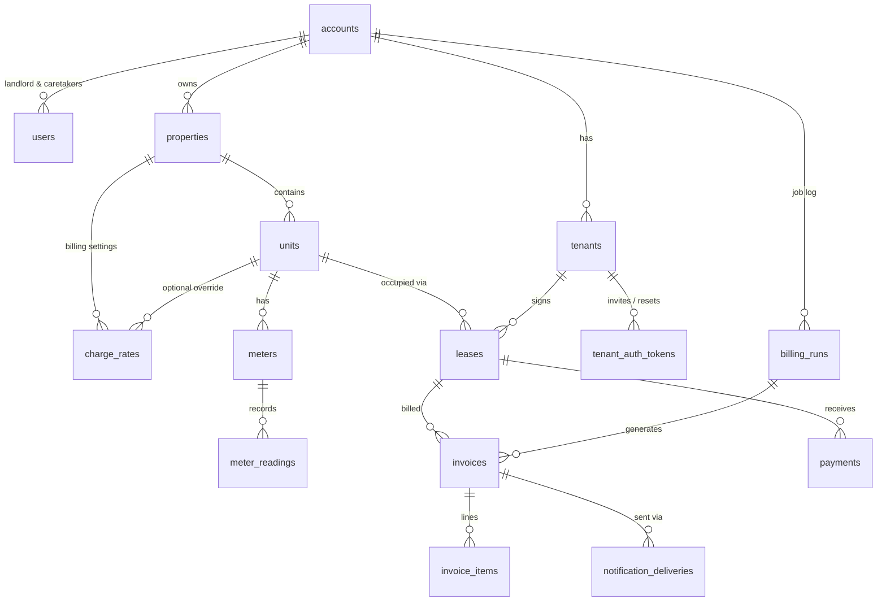

# Kims Properties — Database Schema (v1)

Laravel migrations live in `database/migrations/`. Copy them into a fresh Laravel 11/12 project
(they extend Laravel's default `users` table rather than replacing it) and run `php artisan migrate`.
Target database: MySQL 8 or PostgreSQL. All money is `decimal(12,2)` in the account's currency (KES).

## Entity relationships



## Tables at a glance

| Table | Purpose |
|---|---|
| `accounts` | One landlord business — the multi-tenancy boundary. Holds cycle length (29 days), due-days, currency, channel settings. |
| `users` | Admin portal logins. `role` = super_admin (no account) / landlord / caretaker. |
| `properties` | Buildings/plots a landlord owns. |
| `units` | Houses inside a property (`7-7`), with asking rent and occupancy status. |
| `charge_rates` | Landlord settings: electricity & water price per unit (metered), garbage fee (fixed), plus any extra charges. Versioned by date; optional per-unit override. |
| `tenants` | Tenant portal logins: email **or** national ID + password. Password is null until the invitation is accepted. |
| `tenant_auth_tokens` | Hashed one-time links for invitations and password resets. |
| `leases` | Tenant ↔ unit occupancy. **Rent per occupied house** lives here (`monthly_rent`), as does `next_billing_date`. |
| `meters` / `meter_readings` | Electricity and water meters per unit and their readings each cycle. |
| `billing_runs` | Audit log of each billing-job execution per account. |
| `invoices` / `invoice_items` | The monthly bill and its lines, with readings and rates snapshotted. |
| `payments` | Money received (M-Pesa, bank, cash) against a lease. |
| `notification_deliveries` | One row per message per channel (email / SMS / WhatsApp) with delivery status. |

## How the paper bill maps to the schema

| Paper bill | Stored as |
|---|---|
| House No 7-7 | `units.unit_number` |
| Rent 15,000 | `invoice_items` (charge_code `rent`, rate = `leases.monthly_rent`) |
| Electricity 100 → 180, 80 units × 30 = 2,400 | `invoice_items` with previous/current reading, quantity 80, rate 30 |
| Water 70 → 75, 5 units × 170 = 850 | same, charge_code `water` |
| Garbage 250 | `invoice_items` (fixed `charge_rates` row) |
| Arrears 1,000 | `invoices.balance_brought_forward` |
| Total 19,500 | `invoices.total_due` = current_charges 18,500 + arrears 1,000 |

## Billing job (runs daily, bills leases whose cycle is due)

Running daily instead of on one fixed date lets each lease keep its own 29-day cycle from its move-in date.

1. For each active account, create a `billing_runs` row.
2. Select `leases` where `status IN ('active','notice') AND next_billing_date <= today`.
3. For each lease (in a DB transaction):
   - Period = `last_billed_on + 1` (or `start_date`) → `next_billing_date - 1`.
   - **Rent** line from `leases.monthly_rent`.
   - **Metered** lines: for each active meter on the unit, take the latest reading ≤ period end and the previous reading (or `initial_reading`); quantity = difference; rate = the `charge_rates` row for that charge code effective at period end (unit override first, then property-wide). If a reading is missing, skip the lease and log it in `billing_runs.errors` so the caretaker can capture it.
   - **Fixed** lines: every other effective fixed `charge_rates` row (garbage, security…).
   - `balance_brought_forward` = lease balance (see Payments).
   - Insert the invoice; the unique key `(lease_id, period_start)` makes a re-run harmless.
   - Advance `last_billed_on` and `next_billing_date += accounts.billing_cycle_days`.
4. Dispatch one queued notification per channel the tenant has enabled; each creates a `notification_deliveries` row.

In Laravel: `Schedule::job(new GenerateDueInvoices)->dailyAt('06:00')` with per-lease jobs on the queue.

## Payments and arrears

Balances run per lease, like a statement:

```
lease balance = opening_balance + Σ invoices.current_charges (not void) − Σ payments.amount (confirmed)
```

The next invoice snapshots this as its arrears line. A payment carries the `invoice_id` of the bill
that was open when it arrived, which updates that invoice's `amount_paid` and status
(`partially_paid` / `paid`). Overpayments simply produce a negative balance (credit) on the next bill.

## Design decisions

**Confirmed (13 Oct 2026):**

1. **Tenants are scoped per landlord account.** Landlords cannot see whether a person rents elsewhere. A person renting from two landlords has two records; the portal login asks which landlord if their email/ID matches both.
2. **Rates are versioned, not edited.** Changing the electricity price closes the old `charge_rates` row and opens a new one, so past bills stay reproducible.
3. **Arrears are a running balance per lease** (see Payments and arrears above).

**Working assumptions (not yet discussed):**

4. **Rent lives on the lease**, `units.default_rent` is only the pre-fill when creating a lease.
5. **Tenant isolation in code:** every landlord-owned model should use a `BelongsToAccount` trait with a global scope on `account_id`, set from the logged-in user. Super admins bypass the scope.
6. **Auth:** two guards — `web`/Sanctum for `users` (admin portal) and a `tenant` guard for `tenants` (tenant portal), both serving the React SPA via Sanctum.

## Not yet included (natural next tables)

Expenses/maintenance requests, deposit refunds, M-Pesa C2B/STK callback logs, per-account SMS/WhatsApp credentials (currently in `accounts.settings`), and a general `audit_logs` table.
